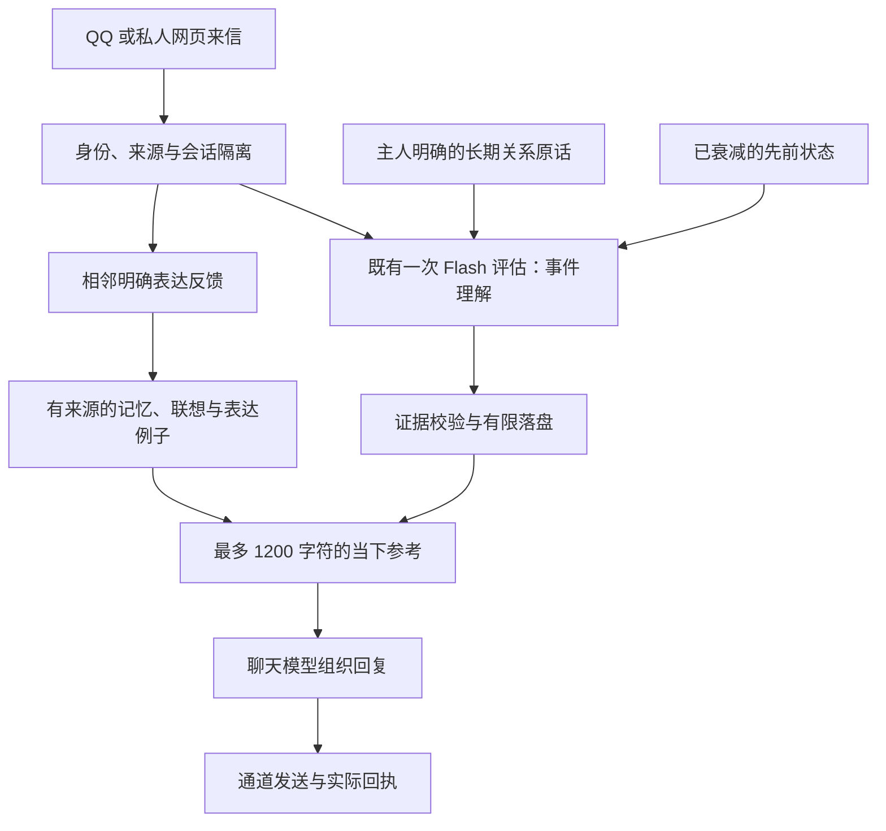

# 星河系统 · Xinghe System

**泡泡的持续状态、记忆、关系与表达系统，以及配套聊天与多模态能力的公开代码快照。**

> **来源与署名：**本项目包含派生自 [dsh-qq-bridge](https://github.com/Yuuyuko-uu/dsh-qq-bridge)、[dsh-speak-up](https://github.com/Yuuyuko-uu/dsh-speak-up)、[dsh-feiyu-mood](https://github.com/Yuuyuko-uu/dsh-feiyu-mood)、[dsh-fish-memory](https://github.com/Yuuyuko-uu/dsh-fish-memory)、[dsh-bili-subagent](https://github.com/Yuuyuko-uu/dsh-bili-subagent) 的组件，原作者 **Yuuyuko-uu**。由 **ebi233** 维护泡泡项目的集成与扩展：新增星河七模块、事件与关系分离、个人表达积累、来源校验、会话隔离、有限上下文编译和接入实验。第三方部分保留原署名与许可；详见 [来源及修改说明](docs/ATTRIBUTION.md) 和 [LICENSE](LICENSE)。本项目不将社区插件整体宣称为从零原创。

[星河工作原理](docs/XINGHE.md) · [全部系统与功能](docs/SYSTEMS.md) · [部署与配置](docs/SETUP.md) · [验收与限制](docs/STATUS.md) · [隐私与发布范围](docs/PRIVACY.md)

## 星河是什么

星河为 AI 角色保存跨轮连续的状态，区分真实消息、模型解释、长期关系和临时反应，并从有来源的记忆及表达材料中选出少量当前参考。模型仍负责理解和组织回复；星河负责把“现在知道什么、哪些记录相关、哪些信息不该混进来”组织清楚。

它不是另一套大模型，也不修改模型权重。所谓“学习表达”是保存和选取真实对话例子与明确反馈，不是在线微调；状态是程序估计，不是生物情绪或激素。

## 七个核心模块

| 模块 | 主要作用 |
| --- | --- |
| 状态中枢 | 情绪与活动倾向连续变化、按时间衰减、证据去重、置信度和来源检查 |
| 事件理解 | 复用已有评估，分开当前原话、事件解释、可修正反应与明确关系依据 |
| 记忆与遗忘 | 按会话、相关性、纠正、版本和有效期选取记忆；读取不强化，旧版本不复活 |
| 联想 | 从当前话题与已有证据建立最多一个可选连接，不编造共同经历 |
| 动机与抉择 | 在回应、继续话题、探索和安静之间选择；安静时实际跳过主动生成 |
| 个人表达积累 | 保存相邻明确认可的对话，允许自主选例先试用；否定退出参考，原记录保留 |
| 自主调整与验收 | 有限参数试算、按版本修改、诊断与回滚；权限限定在可信主私聊 |

内部目录仍叫 `dsh-tidal`，保留已有状态兼容性；对外统一称“星河”。

## 配套系统

| 系统 | 主要功能 | 代码入口 |
| --- | --- | --- |
| QQ 聊天桥接 | 主私聊/访客/群隔离、批量消息承接、发言门槛、回执、主动调度 | `runtime/srv/dsh-qq-bridge/` |
| 长期记忆与表达库 | 有来源事实、偏好、近期对话、纠正、表达反馈与知识库 | `runtime/srv/dsh-qq-ext/dsh-long-memory/` |
| 状态与关系 | 持续状态、事件评估、独立关系依据、1200 字符内的当前参考 | `runtime/srv/dsh-qq-ext/dsh-tidal/` |
| 人格与上下文 | 完整人格版本、摘要来源检查、维护消息隔离、回复诊断 | `runtime/srv/dsh-qq-ext/dsh-persona-integrity/` |
| 模型分流与费用控制 | 聊天/后台模型分流、显式推理档位、按需工具和上下文整理 | `dsh-creative-sampling/`、`dsh-token-economy/` |
| 视觉、图片与语音 | 图片来源/会话检查、识图、生成需求交接、成图回执、ASR/TTS 连接 | `dsh-vision/`、`dsh-draw/`、`runtime/srv/dsh-voice/` |
| 兴趣和公开内容 | B 站阅读、浏览记录、公开内容探索、短媒体辅助节点 | `dsh-public-social/`、`dsh-bili-subagent/`、`dsh-short-media/` |
| 私人网页入口 | 专用鉴权、可见消息和图片、待确认发送记录，网页回复不重复发 QQ | `dsh-qq-bridge/lib/private-chat*` |
| 独立云端 QQ 实验 | 腾讯原生客户端适配、固定接口、文字/图片、有限补收和去重 | `experimental/qq-cloud/` |

上表中的短路径均位于 `runtime/srv/dsh-qq-ext/`。各模块依赖、工作边界见 [系统目录](docs/SYSTEMS.md)。

## 消息怎样经过系统



## 获取与本地检查

```bash
git clone https://github.com/ebi233/the-milky-way-system.git
cd the-milky-way-system
npm test
```

检查使用 Node.js 22+ 与 Python 3.10+；无需安装 npm 依赖，不访问模型、不发送 QQ、不需要账号密钥。完整宿主运行仍依赖 DSH、对应插件依赖及外部服务，不能把测试命令当成完整安装命令。

这是 **2026-11-14 核对当前云端代码后整理的公开快照**，不是包含私人数据的整机备份，也不是已经验证的一键安装发行版。公开配置保留聊天 **Flash/max** 的显式示例；真实账号和登录凭证由部署者在本机配置。

## 实际进度

- 星河七模块及后续事件/关系、记忆联想和表达积累已接入原项目。
- 独立 QQ 实验已通过指定好友文字和图片、首次新图下载、指定群文字、重启收发、短时停机补收与去重；用户已确认对应消息显示正常。
- **正式泡泡仍使用 OneBot/NapCat。** 独立 QQ 实验尚未替换正式桥接，也不等于完整 NapCat 功能兼容。
- 程序通过不代表自然度、语义准确率、长期稳定或费用改善已经验证。新的完整安装流程、长期运行、更多消息类型仍需验收。

详细检查结果见 [验收记录](docs/STATUS.md)。

## 发布范围与许可

不包含真实聊天、长期记忆内容、表达语料、人设原文、私人关系、账号标识、凭证、登录态、用户图片、模型权重或腾讯 QQ 二进制。保留系统代码、通用样例、必要版权文件和可复跑检查。

项目整体按根目录 [LICENSE](LICENSE) 的署名和衍生许可要求分发；已有第三方目录保留各自的 MIT / Apache-2.0 等许可，不用顶层文件替换它们。来源、修改范围和许可边界见 [ATTRIBUTION](docs/ATTRIBUTION.md)。
