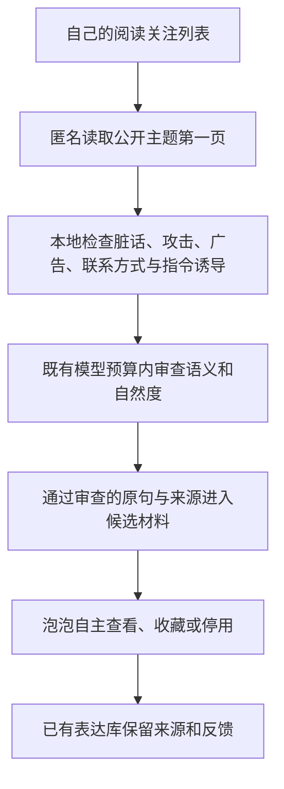

# 贴吧阅读与表达材料

泡泡可以维护自己的贴吧阅读列表，从公开帖子中挑选温和、自然的日常表达，保存到已有表达库。这里的“关注”是星河内部的阅读订阅，不是登录百度账号后点击关注，也不具备发帖、评论或私信能力。

## 自己选吧

可信主人私聊中的 `expression_library` 工具新增三个动作：

| 动作 | 用途 |
| --- | --- |
| `forums` | 查看阅读列表及当前版本 |
| `follow_forum` | 添加一个自己感兴趣的吧，记录选择理由 |
| `unfollow_forum` | 移除不想继续阅读的吧 |

修改时传入 `forum`、`reason` 和刚读取的 `revision`；版本过期会拒绝修改，需重新读取。最多关注 12 个吧。初始提供多肉、花卉、烘焙三个选项，不是固定白名单，也不是声称泡泡已经自己选过它们。允许全部移除，此时暂停贴吧读取。列表保存在宿主数据目录的 `public-social/tieba-follows.json`，不写入公开仓库。

选择权通过工具交给聊天模型，没有额外常驻模型替她决定兴趣。只有可信主私聊可以使用该工具；群聊、访客及网页里的文字不能修改列表。关注一个吧不代表认可其中的所有内容，新增的吧仍逐帖走完整筛选。

## 阅读到学习的过程



本地检查统一全角字符、零宽字符和常见分隔写法。任意已读取楼层不合格时，拒绝这一组材料，不把脏话删掉再当合格原句。语义审查要求温和、日常对话、没有敌意或指令诱导；只允许选择源材料中的 1–3 条原句，不能生成或改写引用。未通过的正文不进入浏览历史或表达库。

通过筛选后，仍只是候选。泡泡通过原有表达库接口决定收藏、试用或停用；公开材料不会自动塞进每轮提示词，不覆盖人设，也不训练模型权重。引用可追溯到原帖，并保留“公开片段”来源性质，不能变成泡泡自己的经历。筛选只能降低风险，不能保证识别所有隐晦辱骂和语境；实际自然度仍需观察对话反馈。

## 复用的开源链路

读取基于 [lumina37/aiotieba](https://github.com/lumina37/aiotieba) 的 [v4.8.4](https://github.com/lumina37/aiotieba/releases/tag/v4.8.4)，遵循其 Unlicense。复用协议组包与解析；项目自己的 `tieba-api-reader.py` 负责匿名、只读且受限的 HTTPS 传输。没有使用库的默认不校验证书传输设置。接口结构依赖这个精确版本，升级应重新验证。

- 仅允许 `tiebac.baidu.com` 的主题列表和帖子阅读路径，强制 HTTPS 并验证证书；不跟随重定向，不使用登录 Cookie 或 BDUSS。
- 单轮至多两个请求，单次响应上限 1 MiB；读取首屏有限楼层，不递归爬取。
- 请求超时 7 秒、总网络时间 16 秒、父进程上限 18 秒。
- 核对返回的吧名、主题与楼层标识；剔除作者资料，只留下必要公开文字。
- 平台限制触发 6 小时退避，其他失败或无合格内容退避 1 小时；读取失败不调用审查模型。
- 与其他公开阅读共享原有每日次数、模型次数和 token 上限，未新建独立预算。审查和工具调用仍可能花费 token。
- 贴吧材料不会进入群发或 QQ 空间发布候选。

## 安装与配置

离线单元检查无需安装 aiotieba；实际读取需要 Linux 上的 Python 3.11+ 及固定依赖：

```bash
python3 -m venv /srv/dsh-cloud/tieba-reader-4.8.4/venv
/srv/dsh-cloud/tieba-reader-4.8.4/venv/bin/pip install -r requirements-tieba.txt
```

宿主服务用户须能读取并执行该虚拟环境；这是默认读取器使用的路径。不同安装布局需要调整读取器调用路径。此步骤是可选阅读组件的依赖安装，不是完整 DSH 安装。

将 [示例字段](../examples/tieba-public-social.json) 合并到现有公开阅读配置的 `platforms` 等对应项，保留自己的原有平台和预算，不用示例文件覆盖私人配置。确保 `enabled` 为真且 `platforms` 包含 `tieba`。阅读仍遵守原有调度和日限额，启用不保证立刻读帖。

可通过 `dsh-public-social/state` 查看 `tieba` 状态中的启用情况、当前列表、是否已经自主选择、只读与预算标志。该端点应保持宿主原有本地访问边界。

```bash
npm run test:tieba
```

检查覆盖内容拒绝、准确引用、共享预算、失败退避、权限、订阅版本控制、列表清空、外部新兴趣、资料投影及表达库流转。运行不联网、不发送消息、不调用模型。实际运行情况见 [本轮记录](TIEBA-20261116.md)。
